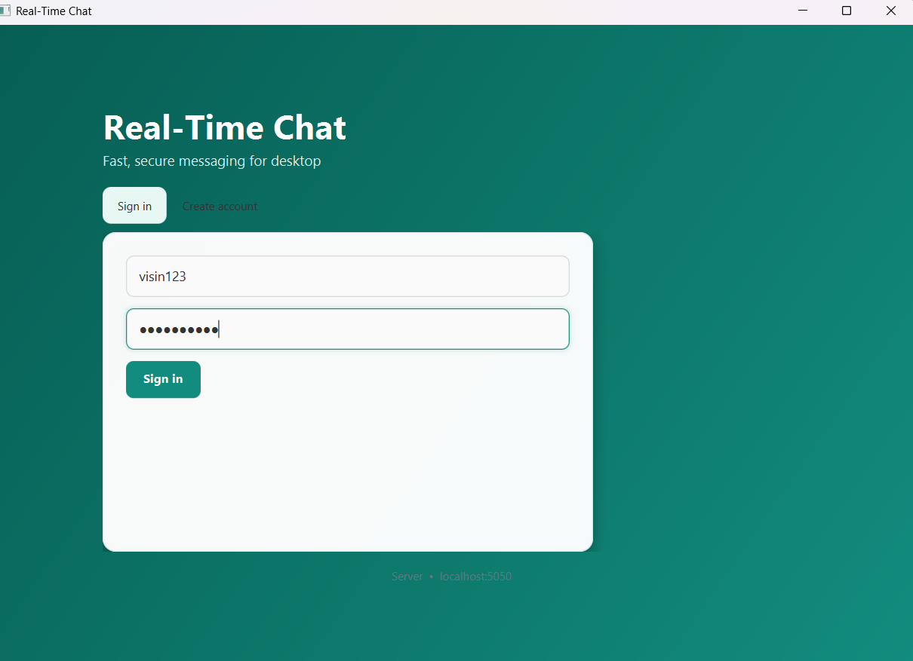

# Real-Time Chat Application

> A secure, database-backed real-time chat system built with Java 21 over TCP, featuring a WhatsApp-style JavaFX desktop client.

[](https://www.java.com/)
[](https://maven.apache.org/)
[](https://www.mysql.com/)
[](https://www.docker.com/)
[](https://openjfx.io/)

## Screenshots

> Add screenshots here — drag and drop images into this file on GitHub

| Sign In | Chat |
|---|---|
|  |  |

## Features

### Messaging
- WhatsApp-style chat bubbles — green for sent, white for received
- Real-time private and group messaging over TCP
- Delivered and read receipts with blue double-tick indicators
- Typing indicators
- Last message preview in contact list
- Paginated message history (100 messages per load)
- Message search

### Files
- Private file sharing up to 5 MB
- SHA-256 integrity verification on download
- File cards with filename, size, and Download button

### Presence & Groups
- Online/offline presence broadcasting
- Group creation, joining, messaging, and history
- Sender name shown above received group messages

### Security
- BCrypt password hashing
- 256-bit cryptographically random session tokens
- Generic auth failure responses (no account enumeration)
- Optional TLS transport
- Prepared statements throughout (no SQL injection surface)
- Non-root Docker container execution

### Infrastructure
- MySQL 8 persistence with SENT/DELIVERED/READ message states
- Docker Compose deployment
- Java 21 virtual threads for async message delivery
- JUnit protocol tests and GitHub Actions CI
- Weekly Dependabot updates
- Build provenance attestations

## Tech Stack

| Layer | Technology |
|---|---|
| Language | Java 21 |
| UI | JavaFX |
| Transport | Raw TCP sockets, 4-byte length-prefixed JSON frames |
| Auth | BCrypt + 256-bit session tokens |
| Database | MySQL 8 via JDBC |
| Packaging | Docker + Docker Compose |
| Build | Maven 3.9+ |
| CI | GitHub Actions |

## Architecture

```text
JavaFX Client ────────── TCP / TLS + JSON ──────────► ChatServer
     │                                                      │
     │                                               ClientHandler
     │                                                      │
  UI Thread ◄──── Platform.runLater ────────────── Reader Thread
                                                           │
                                              ┌────────────┴────────────┐
                                         AuthService              MessageService
                                              │                         │
                                         UserRepository          MessageRepository
                                              └────────────┬────────────┘
                                                           │
                                                       MySQL 8
```

## Quick Start

### Prerequisites
- Java 21+
- Maven 3.9+
- Docker + Docker Compose

### Run the server

```bash
git clone https://github.com/hack2ai/realtime-chat-app.git
cd realtime-chat-app
cp .env.example .env   # set CHATAPP_DB_PASSWORD and CHATAPP_MYSQL_ROOT_PASSWORD
docker compose up -d
```

### Run the client

```bash
mvn javafx:run
```

Enter your server IP and port 5050 on the login screen.

## Configuration

| Variable | Description |
|---|---|
| `CHATAPP_DB_PASSWORD` | MySQL application user password |
| `CHATAPP_MYSQL_ROOT_PASSWORD` | MySQL root password |
| `CHATAPP_DB_HOST` | Database host (default: db) |
| `CHATAPP_DB_PORT` | Database port (default: 3306) |

## License

MIT
